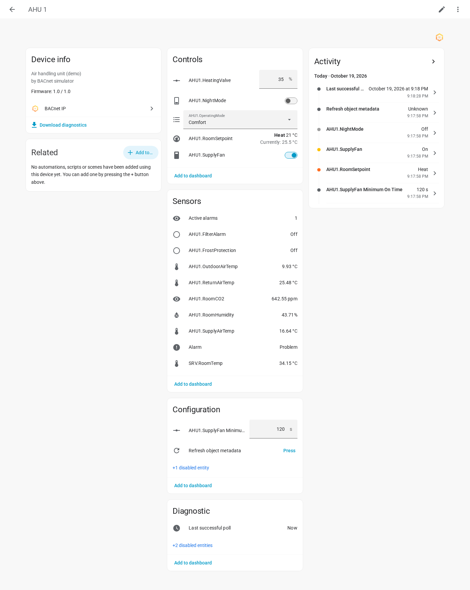
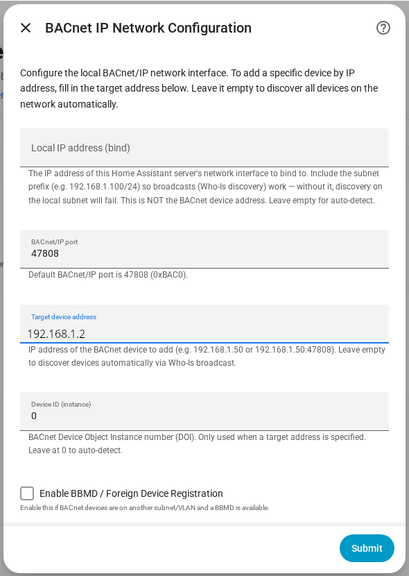
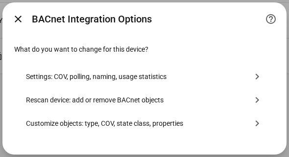
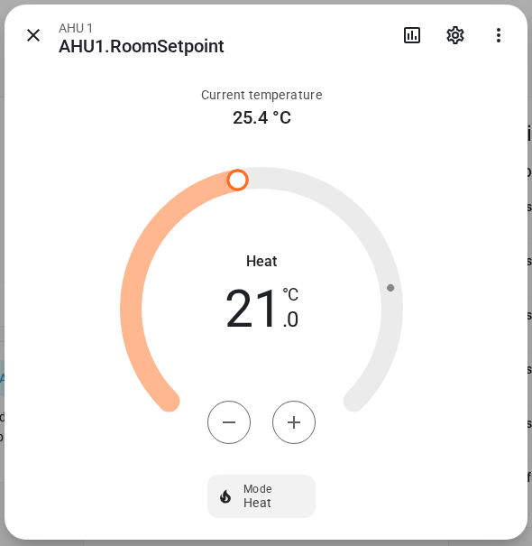

  

<h1 align="center">BACnet IP Integration for Home Assistant</h1>

  
  
  
  
  

  Connect your building automation system to Home Assistant — no YAML, no hassle. 
  Monitor sensors, control outputs, and automate your BACnet/IP devices through a simple GUI.

  <strong>HACS Compatible</strong> · GUI-only setup · Real-time COV updates · BACnet/IP (ASHRAE 135)

  <a href="https://brdc.nl/en/home-assistant-bacnet-integration/">Project page</a> ·
  <a href="https://brdc.nl/nl/home-assistant-bacnet-integration/">Nederlands</a> ·
  <a href="https://brdc.nl/de/home-assistant-bacnet-integration/">Deutsch</a>

---

> **This integration is free and stays free.** It is built and maintained in spare time: new features, support for more devices, answering issues and testing against real controllers. How much time goes into it depends on support from the people who use it. If it saves you time or money, please consider sponsoring or buying me a coffee.
>
> **No budget? A star helps too.** It costs nothing, takes one click on the ★ Star button of the [GitHub repository](https://github.com/CervezaStallone/Home-Assistant-BACnet-integration) and helps other Home Assistant users find the integration.
>
> 
> 
> 

> **Please tick "Share usage statistics".** BACnet devices behave differently per manufacturer, model and firmware, and I can't buy every controller to test on. The usage report tells me which devices the integration runs on, and that is how the [tested devices list](#tested-devices) grows and how I know where to focus fixes. It is opt-in and off by default. It sends no IP addresses, names or values: only the device's manufacturer, model and firmware, version numbers and a few counts, every 6 hours. Turn it on in the last setup step or later in a device's options. Every field is listed under [Privacy and usage statistics](#privacy-and-usage-statistics).

**Contents:** [What it does](#what-does-this-integration-do) · [Documentation](#documentation) · [Features](#features-at-a-glance) · [Safety](#safety-on-a-live-site) · [Screenshots](#screenshots) · [Object types](#supported-object-types) · [Tested devices](#tested-devices) · [Installation](#installation) · [Getting started](#getting-started) · [Troubleshooting](#troubleshooting) · [Privacy](#privacy-and-usage-statistics) · [Requirements](#requirements) · [Contributing](#contributing) · [License](#license)

## What does this integration do?

This custom integration lets Home Assistant talk to **BACnet/IP** devices — the protocol used in professional building automation for HVAC, lighting, access control, and energy management.

In plain terms: if your building has BACnet controllers, thermostats, sensors, or actuators, this integration brings them into Home Assistant so you can monitor and control them from your dashboard, automations, and scripts.

**No YAML configuration required.** Everything is set up through the Home Assistant GUI.

## Documentation

The full documentation lives on brdc.nl:

- **English:** [https://www.brdc.nl/en/docs/bacnet/](https://www.brdc.nl/en/docs/bacnet/)
- **Nederlands:** [https://www.brdc.nl/nl/docs/bacnet/](https://www.brdc.nl/nl/docs/bacnet/)
- **Deutsch:** [https://www.brdc.nl/de/docs/bacnet/](https://www.brdc.nl/de/docs/bacnet/)

Step-by-step guides: [water meter](https://www.brdc.nl/en/docs/bacnet/guide-water-meter/) · [energy meter](https://www.brdc.nl/en/docs/bacnet/guide-energy-meter/) · [climate](https://www.brdc.nl/en/docs/bacnet/guide-climate/) · [BBMD / other subnet](https://www.brdc.nl/en/docs/bacnet/guide-bbmd/) · [multi-state select](https://www.brdc.nl/en/docs/bacnet/guide-multistate-select/) · [schedule and holidays](https://www.brdc.nl/en/docs/bacnet/guide-schedule-holiday/) · [switch and priority](https://www.brdc.nl/en/docs/bacnet/guide-switch-priority/)

Reference: [Installation](https://www.brdc.nl/en/docs/bacnet/installation/) · [Getting started](https://www.brdc.nl/en/docs/bacnet/getting-started/) · [Configuration options](https://www.brdc.nl/en/docs/bacnet/configuration/) · [Entities and attributes](https://www.brdc.nl/en/docs/bacnet/entities/) · [How writes work](https://www.brdc.nl/en/docs/bacnet/writes/) · [Actions (services)](https://www.brdc.nl/en/docs/bacnet/actions/) · [Schedules](https://www.brdc.nl/en/docs/bacnet/schedules/) · [Trend logs](https://www.brdc.nl/en/docs/bacnet/trend-logs/) · [Alarms](https://www.brdc.nl/en/docs/bacnet/alarms/) · [Extra properties](https://www.brdc.nl/en/docs/bacnet/extra-properties/) · [Climate](https://www.brdc.nl/en/docs/bacnet/climate/) · [Examples](https://www.brdc.nl/en/docs/bacnet/examples/) · [Troubleshooting](https://www.brdc.nl/en/docs/bacnet/troubleshooting/)

---

## Features at a glance

- **Three-step setup wizard** with automatic device discovery (Who-Is / I-Am) — [Getting started](https://www.brdc.nl/en/docs/bacnet/getting-started/)
- **Cross-subnet support** through BBMD / Foreign Device Registration — [guide](https://www.brdc.nl/en/docs/bacnet/guide-bbmd/)
- **Real-time updates via COV**, with automatic polling fallback
- **Read and write** with proper BACnet Priority Array handling — [How writes work](https://www.brdc.nl/en/docs/bacnet/writes/)
- **Per-object customization** — entity type, COV, state class, selective import — [Configuration](https://www.brdc.nl/en/docs/bacnet/configuration/)
- **Services** to relinquish, write any property and read any property — [Actions](https://www.brdc.nl/en/docs/bacnet/actions/)
- **Alarms** as binary sensor, sensor and event — [Alarms](https://www.brdc.nl/en/docs/bacnet/alarms/)
- **Trend logs and schedules** — [Trend logs](https://www.brdc.nl/en/docs/bacnet/trend-logs/), [Schedules](https://www.brdc.nl/en/docs/bacnet/schedules/)
- **Climate** with a real room temperature — [Climate](https://www.brdc.nl/en/docs/bacnet/climate/)
- **Energy dashboard** support for energy, power, flow and volume — [energy meter guide](https://www.brdc.nl/en/docs/bacnet/guide-energy-meter/)
- **Multi-state select** with `stateText` labels — [guide](https://www.brdc.nl/en/docs/bacnet/guide-multistate-select/)
- **Automatic outage recovery**, Repairs issues, diagnostics download and health sensors
- **Efficient on the network** — batched ReadPropertyMultiple reads
- **English and Dutch** user interface
- **Usage statistics** — opt-in, off by default. Please tick it: it is how the tested devices list grows. See [Privacy and usage statistics](#privacy-and-usage-statistics)

---

## Safety on a live site

Home Assistant writes a value to your devices only when you (or an automation) switch, set or call a service; discovery, polling and COV subscriptions do not change values. Entities write at priority 16 by default, so anything at 1–15 still wins. Details, the one exception (COV increment) and the services that can write at higher priorities are in [How writes work](https://www.brdc.nl/en/docs/bacnet/writes/).

The integration is provided as is, without warranty (GPL-3.0, sections 15–16). Do not use it to control life-safety systems such as fire alarm or smoke control. You are responsible for what you write to a running building; test on a single object first.

---

## Screenshots

*Demo: a simulated air handling unit ("AHU 1"), not a real installation.*

  

<table>
  <tr>
    <td></td>
    <td></td>
  </tr>
  <tr>
    <td align="center">Setup: network settings</td>
    <td align="center">Options: settings, rescan, customize</td>
  </tr>
  <tr>
    <td colspan="2" align="center"> Setpoint as a climate entity</td>
  </tr>
</table>

---

## Supported object types

| BACnet Object | Default entity | Writable? |
|---|---|---|
| Analog Input | Sensor | No |
| Analog Output | Number | Yes |
| Analog Value | Sensor | Auto-detected |
| Binary Input | Binary sensor | No |
| Binary Output | Switch | Yes |
| Binary Value | Switch | Auto-detected |
| Multi-State Input | Sensor | No |
| Multi-State Output | Number | Yes |
| Multi-State Value | Sensor | Auto-detected |
| Schedule | Sensor (current value) | Via `bacnet.write_schedule` |
| Trend Log | Sensor (number of records) | No — records via `bacnet.read_trend_log` |

> Value objects may or may not support writes — the integration auto-detects this by checking for a Priority Array during discovery.
>
> Analog sensors keep long-term statistics: energy and volume objects as a meter (`total_increasing`, usable in the Energy dashboard), all others as a `measurement`. The **state class** setting in [Customize objects](https://www.brdc.nl/en/docs/bacnet/configuration/) changes this per object. A water or gas meter in L or m³ also needs the **meter type** setting before the Energy dashboard lists it. Before 1.0.53, energy and volume sensors were a `measurement`; after updating, **Developer tools → Statistics** may list them with a changed state class. Click **Fix issue** there once per sensor.
>
> Since 1.0.55, more BACnet units get a Home Assistant unit, so the Energy dashboard can use them: L/h, mL/s, m³/s, m³/min, ft³/min, gal/min, gal/h, mL, ft³, gal, J, kJ, MJ and mW. Sensors in these units had no unit before. After updating, **Developer tools → Statistics** lists them with a changed unit and pauses their statistics until you click **Fix issue** once per sensor.
>
> Any object type can be changed to another entity type per object (see [Customize objects](https://www.brdc.nl/en/docs/bacnet/configuration/)). Multi-state objects can also become a **select** that shows their `stateText` labels (e.g. *Off / Heat / Cool*).

## Tested devices

Want to know if your controller works? The list of tested devices shows every BACnet device that users have run with this integration: manufacturer, model, firmware, integration version and what was confirmed to work. You can search and filter it by manufacturer or model.

BACnet is a standard, so a device that isn't listed will most likely work too. The list only shows what has actually been tried. Also available in [Nederlands](https://www.brdc.nl/nl/home-assistant-bacnet-integration/tested-devices/) and [Deutsch](https://www.brdc.nl/de/home-assistant-bacnet-integration/tested-devices/), or as a [plain table on GitHub](https://github.com/CervezaStallone/Home-Assistant-BACnet-integration/blob/master/TESTED_DEVICES.md).

**Works on your device?** [Send a device report](https://github.com/CervezaStallone/Home-Assistant-BACnet-integration/issues/new?template=device_report.yml) with the manufacturer, model and what you've used; it's added to the list once checked. Installations that opted in to [usage statistics](#privacy-and-usage-statistics) add to the list too.

## Installation

### Via HACS (recommended)

The integration is in the default HACS store.

1. Open **HACS** and search for **BACnet IP Integration**, or click the button above
2. Click **Download**
3. **Restart** Home Assistant

Added it earlier as a custom repository? Nothing to do; updates keep coming.

### Manual installation

Copy the `custom_components/bacnet` folder into your Home Assistant `config/custom_components/` directory and restart.

---

## Getting started

1. Go to **Settings → Devices & Services → Add Integration** and search for **BACnet IP**.
2. Fill in the network settings (leave the local IP empty for auto-detect), then pick your device from the discovered list.
3. Choose the objects to import, name the device and click **Submit**.

The full walkthrough, with every network setting explained, is in the [Getting started page](https://www.brdc.nl/en/docs/bacnet/getting-started/).

---

## Troubleshooting

Debug logging, the diagnostics download, advanced tuning and fixes for common problems are in the [Troubleshooting page](https://www.brdc.nl/en/docs/bacnet/troubleshooting/). For automation examples, see [Examples](https://www.brdc.nl/en/docs/bacnet/examples/).

---

## Privacy and usage statistics

The integration can send usage statistics. It is opt-in: **Share usage statistics** on the last setup page is unticked by default, and nothing is sent unless you tick it there or later in a device's options. Please do: the reports are how the tested devices list grows. Installations from before 1.0.51 are asked once, in **Settings → Repairs**: tick to share for all devices, leave it unticked to keep it off. That question never comes back.

While at least one device has it ticked, Home Assistant sends one report every 6 hours (the first about 10 minutes after start) to a server I run, on servers in the EU. The full [privacy policy](PRIVACY.md) (English and Nederlands) explains what is collected, why, how long it is kept and how to have it deleted; the privacy statement on [brdc.nl](https://www.brdc.nl/en/privacy/), linked under the checkbox, summarises it. Only ticked devices are included, and only once they have answered a poll.

What a report contains — everything, nothing else:

| Field | Example | Meaning |
|---|---|---|
| `schema` | `1` | Report format version |
| `install_id` | `3f2b…` | A random ID created by this integration, only used to count installations. Not derived from your Home Assistant |
| `integration_version` | `1.0.50` | Version of this integration |
| `ha_version` | `2026.10.1` | Version of Home Assistant |
| `vendor` | `Siemens` | The device's `vendorName` |
| `model` | `PXC200-E.D` | The device's `modelName` |
| `firmware` | `V6.00.338` | The device's `firmwareRevision` |
| `connection` | `direct` | `direct`, or `foreign_device` when connected through a BBMD |
| `cov` | `true` | Whether at least one COV subscription works |
| `rpm` | `true` | Whether the device accepts ReadPropertyMultiple |
| `objects` | `{"0": 12, "2": 40}` | Number of imported objects per BACnet object type |

**Never sent:** IP or BACnet addresses, device instance numbers, object or device names, descriptions, values, or anything about your Home Assistant setup. The server does not store your IP address with the data; it adds only the country the report came from and the date it arrived.

The reports are kept for statistics (how many installations, which devices and object types are in use). The only thing that ever becomes public is a device's manufacturer, model and firmware, in the [tested devices](#tested-devices) list, after I have checked it.

To stop: untick the option in each device's options. A failed report is never retried and never shows up in your log (only at debug level).

## Requirements

- **Home Assistant** 2024.4.0 or newer
- **Python** 3.12+
- **Network** UDP port 47808 accessible between HA and BACnet devices
- **Cross-subnet** A BBMD or BACnet router if devices are on a different network

---

## Contributing

1. Fork the repository
2. Create a feature branch (`git checkout -b feature/my-improvement`)
3. Submit a Pull Request

---

## License

GPL-3.0 — see [LICENSE](LICENSE) for details. BACpypes3, installed by Home Assistant from PyPI, is MIT-licensed. See [THIRD_PARTY_NOTICES.md](THIRD_PARTY_NOTICES.md).

BACnet® is a registered trademark of ASHRAE. This is an independent open-source integration. It is not affiliated with, endorsed by or certified by ASHRAE, BACnet International or the BACnet Testing Laboratories (BTL). It is not an official Home Assistant integration. It implements a selection of BACnet/IP services with BACpypes3 and is tested on real controllers (see [tested devices](#tested-devices)), not through formal BTL conformance testing.

---

  Developed by <strong><a href="https://brdc.nl">BRDC</a></strong> 
  Powered by <a href="https://github.com/JoelBender/BACpypes3">BACpypes3</a> · Built for <a href="https://www.home-assistant.io/">Home Assistant</a>

